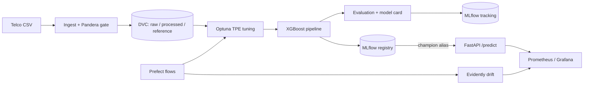

# ChurnGuard

**A production-grade MLOps platform for customer churn prediction.**
Data validation → experiment tracking → model registry with gated promotion →
containerised inference with hot-reload → drift monitoring → infrastructure as code.

Built with Python 3.12, `uv`, scikit-learn/XGBoost, MLflow, Optuna, Prefect,
Pandera, Evidently, FastAPI, Prometheus/Grafana, Docker Compose, Kubernetes
(Helm) and Terraform.

<p>
  <a href="https://github.com/GuptaAman12/churnguard/actions/workflows/ci.yml">
    
  </a>
  
  
</p>

---

## Why this repo exists

Most ML portfolio projects stop at a notebook. This one focuses on the part that
actually breaks in production: **the seams**.

| Seam | Failure mode | What ChurnGuard does |
|---|---|---|
| Notebook → service | Training/serving skew | Feature engineering is embedded *inside* the serialized sklearn pipeline |
| Data → training | Silent schema corruption | Pandera contract gate in the DVC stage; manifests with content fingerprints |
| Training → production | Unreviewed model swaps | MLflow registry + `champion` alias + quality/regression gates with audit tags |
| Production → operator | "It's down and we don't know why" | `/health`, `/ready`, `/model/info`, Prometheus metrics, Grafana dashboard, alert rules |
| Model → reality | Concept/data drift | Evidently drift reports, per-feature p-values, Prometheus export, retraining flow |
| Local → cloud | Snowflake environments | One container image, 12-factor config, Compose for dev, Terraform/ECS + Helm for prod |

## Results

Reproduced locally with `python -m churnguard.cli bootstrap --n-trials 12`
(IBM Telco Customer Churn, 7,043 rows, 26.5% churn, stratified 80/20 split).

| Metric | Test value |
|---|---|
| ROC-AUC | **0.8475** |
| PR-AUC | **0.6625** |
| Accuracy | **0.7828** |
| F1 (tuned threshold) | **0.6458** |
| Precision | **0.5694** |
| Recall | **0.7460** |
| Specificity | **0.7961** |
| Log loss | **0.4852** |
| Brier score | **0.1630** |
| Decision threshold | **0.5800** |

Cross-validated ROC-AUC during tuning: **0.8498** (12 Optuna trials, 5 folds).
The candidate (v2, AUC 0.8475) was automatically promoted over the previous
champion (v1, AUC 0.8153) because it cleared both the absolute floor and the
no-regression gate.

> Numbers are regenerated by every training run and logged to MLflow along with
> a model card, subgroup metrics, ROC curve and feature importances. The table
> above is a snapshot — see `models/model.json` for the latest artifact metadata.

## Architecture



Full design notes: [`docs/architecture.md`](docs/architecture.md) ·
ADRs: [`docs/adr/`](docs/adr/) · Runbook: [`docs/runbook.md`](docs/runbook.md) ·
Model card: [`docs/model-card.md`](docs/model-card.md)

## Quickstart (5 minutes, no Docker)

Requires [uv](https://docs.astral.sh/uv/) and Python 3.12.

```bash
uv sync --all-groups

# 1. Download, validate and split the dataset (DVC pipeline)
uv run dvc repro

# 2. Train + tune + register a champion
uv run python -m churnguard.cli train --n-trials 10

# 3. Serve it (falls back to the local artifact if MLflow is offline)
uv run python -m churnguard.cli serve --reload
```

Then:

```bash
curl -s 127.0.0.1:8000/ready
curl -s 127.0.0.1:8000/model/info

curl -s -X POST 127.0.0.1:8000/predict \
  -H 'content-type: application/json' \
  -d '{
    "gender": "Female", "SeniorCitizen": 0, "Partner": "Yes", "Dependents": "No",
    "tenure": 3, "PhoneService": "Yes", "MultipleLines": "No",
    "InternetService": "Fiber optic", "OnlineSecurity": "No", "OnlineBackup": "No",
    "DeviceProtection": "No", "TechSupport": "No", "StreamingTV": "Yes",
    "StreamingMovies": "No", "Contract": "Month-to-month", "PaperlessBilling": "Yes",
    "PaymentMethod": "Electronic check", "MonthlyCharges": 95.5, "TotalCharges": 286.5
  }'
```

Output:

```json
{
  "prediction_id": "6f1c9a2e-5b7d-4c1a-9f0e-2b8d3a4c5e6f",
  "churn_probability": 0.903333,
  "churn_prediction": true,
  "risk_tier": "high",
  "thresholds": { "decision": 0.58 },
  "model": { "name": "churnguard-churn-classifier", "version": "2", "source": "registry", ... }
}
```

### One-command end-to-end demo

```bash
uv run python -m churnguard.cli bootstrap --n-trials 10
```

Runs ingest → split → tune → train → register → batch scoring → drift
simulation → drift report, and prints a JSON summary of every stage.

## Full local platform (Docker Compose)

```bash
cp .env.example .env
docker compose build
docker compose up -d postgres mlflow
docker compose run --rm trainer
docker compose up -d
```

| Service | URL |
|---|---|
| Prediction API (OpenAPI docs) | http://localhost:8000/docs |
| MLflow tracking + registry | http://localhost:5000 |
| Prefect orchestration | http://localhost:4200 |
| Prometheus | http://localhost:9090 |
| Grafana (admin / admin) | http://localhost:3000 |

The Grafana dashboard is provisioned from
[`configs/grafana/dashboards/churnguard.json`](configs/grafana/dashboards/churnguard.json):
model-loaded status, request rate, p50/p95 latency, predictions by risk tier,
drift share and drifted-feature count.

MLflow artifacts are stored in `./mlartifacts` locally (S3 in production), and
Prefect keeps its metadata in a dedicated `prefect` database inside the shared
PostgreSQL instance.

## What's inside

### Data & validation

- `ingest.py` — atomic download (temp file → validate → move), synthetic
  fallback for offline CI.
- `schema.py` — Pandera schemas for raw, processed and inference contracts,
  with structured failure cases.
- `data.py` — cleaning, stratified split, SHA-256 content fingerprints, dataset
  manifests written next to every artifact.
- `dvc.yaml` / `dvc.lock` — reproducible ingest → split pipeline; artifacts
  pushed to a configurable remote.

### Training & registry

- `features.py` — deterministic feature engineering (`avg_monthly_spend`,
  `service_count`, `is_month_to_month`, `has_support`) embedded in the pipeline.
- `modeling/train.py` — Optuna TPE search with 5-fold CV ROC-AUC, XGBoost with
  class weighting, threshold tuning, subgroup metrics, model card generation,
  MLflow logging and registry registration.
- `modeling/registry.py` — champion lookup, gated promotion, lineage tags
  (`git_sha`, `data_fingerprint`, `decision_threshold`, `promotion_reason`).
- `modeling/evaluate.py` — AUC, PR-AUC, calibration (Brier/log loss),
  confusion matrix, ROC curve and disaggregated fairness slices.

### Serving

- FastAPI with typed Pydantic contracts (`extra="forbid"`), batch endpoint
  (max 1,000), optional `X-API-Key` auth, request IDs, structured JSON logs.
- `model_loader.py` — registry-first loading with hot-reload polling and a
  joblib fallback + metadata sidecar as a circuit breaker.
- Prometheus metrics: request count/latency, prediction distribution, model
  metadata gauge, drift gauges.
- Prediction logging (rotating JSONL) that doubles as the online drift source.

### Monitoring & orchestration

- `monitoring/drift.py` — Evidently 0.7 per-column tests, HTML + JSON artifacts,
  history snapshots, Pushgateway export, and a statistical fallback that keeps
  working if Evidently breaks.
- `monitoring/simulate.py` — realistic production-shift generator (pricing,
  tenure, contract mix, product mix) for demos and tests.
- Prefect flows — nightly training with promotion gates, six-hourly drift checks
  over live prediction logs.

### Infrastructure

- Multi-stage `Dockerfile` with `uv` layer caching, per-target dependency groups
  (lean API image; training and MLflow extras installed only where needed),
  non-root user, healthchecks, and `api` / `pipeline` / `mlflow` targets.
- `docker-compose.yml` — Postgres, MLflow, API, Prefect server + worker,
  Pushgateway, Prometheus, Grafana.
- Helm chart — Deployment, Service, HPA, PDB, probes, ServiceMonitor, secrets,
  topology spread.
- Terraform — VPC, ECR, RDS Postgres, S3, Secrets Manager, ECS Fargate for API
  and MLflow, ALB with optional HTTPS, Cloud Map service discovery.
- GitHub Actions — lint, strict mypy, tests + coverage, pip-audit, Trivy,
  Docker builds, infra validation, tag-based release with SBOM/provenance.

## Quality gates

```bash
uv run ruff check src tests        # lint
uv run ruff format --check src tests
uv run mypy src                    # strict
uv run pytest                      # 76 tests, coverage gate
uv run pre-commit run --all-files
```

Current state: **78 tests passing**, **~83% branch coverage**, `ruff` clean,
`mypy --strict` clean across 30 source modules.

## Project layout

```
.
├── src/churnguard/
│   ├── api/            # FastAPI app, schemas, model loader, metrics, logs
│   ├── modeling/       # tuning, training, evaluation, registry promotion
│   ├── monitoring/     # drift detection, summary model, simulator
│   ├── flows/          # Prefect training + monitoring flows
│   ├── data.py         # cleaning, splitting, lineage
│   ├── features.py     # pipeline-embedded feature engineering
│   ├── schema.py       # Pandera contracts
│   ├── batch.py        # batch scoring
│   ├── cli.py          # unified CLI
│   └── ...
├── tests/              # unit + integration tests
├── configs/            # Prometheus rules, Grafana provisioning + dashboard
├── infra/
│   ├── helm/churnguard/
│   └── terraform/
├── docs/               # architecture, ADRs, runbook
├── notebooks/          # read-only EDA
├── dvc.yaml            # reproducible data pipeline
└── docker-compose.yml  # full local platform
```

## CLI reference

```
churnguard ingest          Download + validate the raw dataset
churnguard split           Clean, validate, split, fingerprint
churnguard train           Tune, train, evaluate, register, promote
churnguard batch           Score a batch with the active model
churnguard drift           Generate a drift report
churnguard simulate-drift  Create a drifted batch for demos
churnguard serve           Run the FastAPI service
churnguard bootstrap       Full pipeline in one command
churnguard info            Print resolved (masked) configuration
```

## Configuration

All settings are typed and overridable via `CHURNGUARD_*` env vars; secrets are
masked by `churnguard info`. See [`src/churnguard/config.py`](src/churnguard/config.py)
for the full surface. Key knobs:

| Variable | Default | Meaning |
|---|---|---|
| `CHURNGUARD_TRACKING_URI` | `http://localhost:5000` | MLflow tracking server |
| `CHURNGUARD_MODEL_URI` | unset | Override the registry URI (e.g. a run artifact) |
| `CHURNGUARD_API_KEY` | unset | Require `X-API-Key` on predict/reload |
| `CHURNGUARD_MIN_ROC_AUC` | `0.80` | Absolute promotion floor |
| `CHURNGUARD_PROMOTION_TOLERANCE` | `0.005` | Allowed regression vs champion |
| `CHURNGUARD_DRIFT_SHARE_THRESHOLD` | `0.30` | Dataset-drift alert threshold |
| `CHURNGUARD_MODEL_REFRESH_SECONDS` | `60` | Champion hot-reload interval |
| `CHURNGUARD_PUSHGATEWAY_URL` | unset | Batch drift metric export |

## Design trade-offs

- **Pickle serialization** (not skops) is used because the pipeline intentionally
  embeds an in-repo function. The registry is the trust boundary; artifacts are
  produced only by our CI. This is documented rather than hidden.
- **SQLite for local MLflow**, Postgres in Compose/prod. Same client code.
- **No feature store.** For this dataset the transformation is deterministic and
  cheap; a feature store would add operational surface without changing results.
  The ADR explains when that would change.
- **Threshold on the test set** is a deliberate simplification for demonstration;
  a strict setup would tune on a validation split and report once on test.

## License

MIT.
