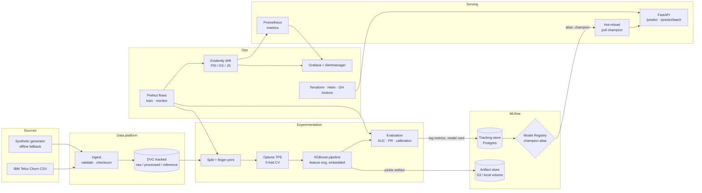

# Architecture

ChurnGuard is a small-but-real MLOps platform. Every stage below is executable
from a single command, and every stage emits artifacts that the next stage (or a
human reviewer) can audit.



## Stage contracts

| Stage | Command | Input | Output | Gate |
|---|---|---|---|---|
| Ingest | `churnguard ingest` | remote CSV | `data/raw/telco_churn.csv` | Pandera raw schema; size sanity check |
| Split | `churnguard split` / `dvc repro` | raw CSV | processed train/test + reference Parquet | Processed schema; stratified split |
| Tune | `churnguard train` | train Parquet | Optuna study | 5-fold stratified CV ROC-AUC |
| Train | `churnguard train` | train Parquet | MLflow run + registry version | Signature inference, model card |
| Promote | automatic | registry version | `champion` alias | AUC ≥ floor **and** no regression > tolerance |
| Serve | `churnguard serve` | registry / fallback | HTTP predictions | `/ready` requires a loaded model |
| Monitor | `churnguard drift` | reference vs current | JSON + HTML + metrics | Drift share ≥ 30% raises an alert |
| Orchestrate | Prefect flows | params | deployment runs | Retries + timeouts per task |

## Design decisions

### 1. Feature engineering lives *inside* the sklearn pipeline

`engineer_features` is wrapped in a `FunctionTransformer` as the first step of
the fitted pipeline. Training and serving therefore execute byte-identical
transformations, which eliminates training/serving skew by construction rather
than by convention.

### 2. The registry is the source of truth; the local file is a circuit breaker

The API prefers `models:/churnguard-churn-classifier@champion`. If MLflow is
unreachable it falls back to `models/model.joblib` plus a JSON sidecar holding
the run id, threshold, metrics and data fingerprint. `/ready` reports which
source is live, so Kubernetes only routes traffic to pods with a model.

### 3. Promotion is a gate, not a button

`decide_promotion` requires **both** an absolute quality floor (`min_roc_auc`)
and no regression versus the current champion beyond a tolerance
(`promotion_tolerance`). Rejected candidates still get lineage tags, which makes
"why wasn't version 7 promoted?" answerable from the registry alone.

### 4. Thresholds are tuned, then frozen into the artifact

F1-optimal thresholds are searched on the test set and logged as
`decision_threshold` on the model version. The API reads the value from the
version tag, so risk tiers stay consistent across deployments and rollbacks.

### 5. Drift detection degrades gracefully

Evidently 0.7 is the primary engine (per-column statistical tests + dataset
drift). If the optional dependency or a specific column type breaks, the module
falls back to a dependency-light KS / chi-square implementation. The API never
depends on Evidently being importable; it only reads `reports/drift/latest.json`.

### 6. Configuration is 12-factor

All knobs are `CHURNGUARD_*` environment variables with typed validation,
documented defaults, and a `.env.example`. The same image runs locally, in
Compose, and on ECS Fargate.

### 7. Calibration is fitted out-of-fold and kept only when it helps

Probabilities are calibrated with isotonic regression fitted on out-of-fold
training predictions, so the test set never influences the curve. The candidate
calibrator is benchmarked on test log loss; if it does not improve, the pipeline
ships uncalibrated and the model card records `calibration_method=identity`.
This is why log loss fell from 0.48 to 0.42 while ROC-AUC was unchanged.

### 8. Explanations use the trees that actually scored the customer

`/explain` calls `Booster.predict(pred_contribs=True)` — exact TreeSHAP computed
by XGBoost itself. No second surrogate model and no external SHAP dependency.
Contributions are in log-odds space; the endpoint returns both the
pre-calibration probability (which the contributions explain) and the served,
calibrated probability.

## Data & model lineage

```
raw CSV ──sha256 fingerprint──► train.parquet ──manifest──► MLflow run
                                        │                        │
                                        └── data_fingerprint ────┤
                                                                 ▼
                                                  model version tags
                                                  · git_sha
                                                  · data_fingerprint
                                                  · decision_threshold
                                                  · promotion_reason
```

Every prediction log line also records `model_version`, so an online incident
can be traced back to an exact run, commit and dataset fingerprint.

## Threat model (abridged)

| Risk | Mitigation |
|---|---|
| Unauthenticated scoring | Optional `X-API-Key` on mutating endpoints; constant-time compare |
| Secret leakage in logs | Structured logs never serialise settings; `churnguard info` masks secrets |
| Untrusted model artifacts | MLflow pickle artifacts are only produced by our own CI; registry ACLs are the trust boundary |
| Prompt-injection / data exfiltration via payload | `extra="forbid"` Pydantic models, strict enums, range checks |
| Resource exhaustion | Batch capped at 1,000 rows; request timeouts at proxy; HPA + PDB |
| Supply chain | Locked `uv.lock`, pip-audit, Trivy, SBOM + provenance on release |
