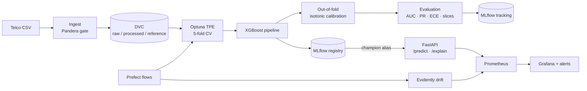
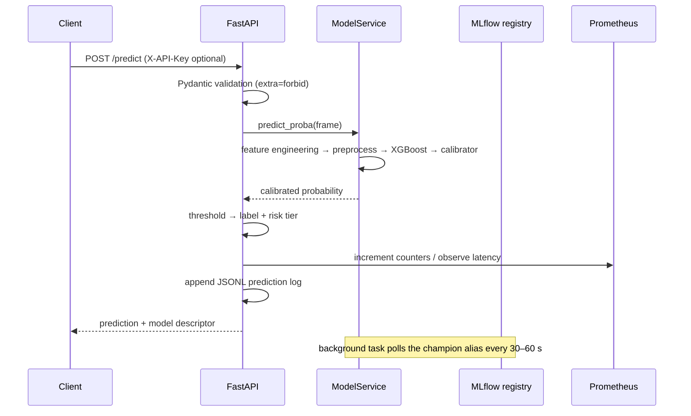
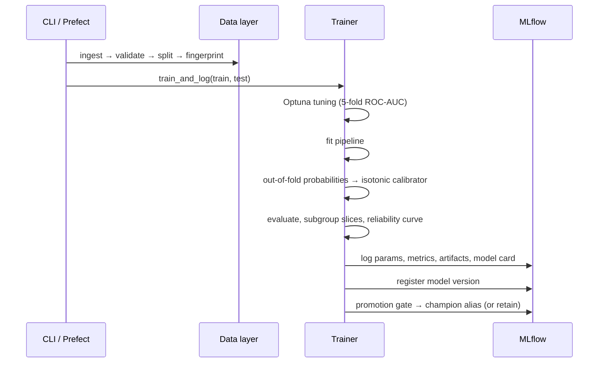

# ChurnGuard — Complete Project Guide

> A production-oriented MLOps platform for customer churn prediction.
> This document explains **what** was built, **why** each decision was made, and
> **how** to run, operate and extend it.

---

## Table of contents

1. [Executive summary](#1-executive-summary)
2. [Problem statement and dataset](#2-problem-statement-and-dataset)
3. [Architecture](#3-architecture)
4. [Repository layout](#4-repository-layout)
5. [Data lifecycle](#5-data-lifecycle)
6. [Feature engineering](#6-feature-engineering)
7. [Training and tuning](#7-training-and-tuning)
8. [Evaluation and calibration](#8-evaluation-and-calibration)
9. [Explainability](#9-explainability)
10. [Model registry and promotion](#10-model-registry-and-promotion)
11. [Serving layer](#11-serving-layer)
12. [Monitoring and observability](#12-monitoring-and-observability)
13. [Orchestration](#13-orchestration)
14. [Containerization and local platform](#14-containerization-and-local-platform)
15. [Kubernetes deployment](#15-kubernetes-deployment)
16. [Cloud infrastructure](#16-cloud-infrastructure)
17. [CI/CD and quality gates](#17-cicd-and-quality-gates)
18. [Security model](#18-security-model)
19. [Testing strategy](#19-testing-strategy)
20. [Configuration reference](#20-configuration-reference)
21. [Running the project](#21-running-the-project)
22. [Results](#22-results)
23. [Design decisions and trade-offs](#23-design-decisions-and-trade-offs)
24. [Limitations and future work](#24-limitations-and-future-work)
25. [Resume and interview notes](#25-resume-and-interview-notes)
26. [Glossary](#26-glossary)

---

## 1. Executive summary

ChurnGuard predicts which telecom customers are likely to churn, and does so as a
**system** rather than a notebook:

| Capability | Implementation |
|---|---|
| Reproducible data | DVC stages + Pandera contracts + SHA-256 fingerprints |
| Experiment tracking | MLflow 3 with params, metrics, artifacts, dataset lineage |
| Model registry | `champion` alias + gated promotion + audit tags |
| Explainability | Exact TreeSHAP contributions via `/explain` |
| Calibrated risk | Out-of-fold isotonic calibration, reliability curve, ECE |
| Serving | FastAPI, hot-reload, fallback artifact, batch + single inference |
| Monitoring | Prometheus metrics, Grafana dashboard, alert rules |
| Drift detection | Evidently 0.7 with a dependency-free statistical fallback |
| Orchestration | Prefect flows for training and drift checks |
| Packaging | Multi-stage Docker images, Compose stack, Helm chart |
| Cloud | Terraform for ECS Fargate, RDS, S3, ALB, Cloud Map |
| Quality | 88 tests, ~83% coverage, `ruff`, `mypy --strict`, security scans |

The project is designed around the failures that actually hurt ML systems:
training/serving skew, silent data corruption, unreviewed model swaps, opaque
predictions, drift, and environments that behave differently from production.

---

## 2. Problem statement and dataset

### Business problem

A telecom operator wants to prioritise retention outreach. For each customer we
estimate the probability of churn and expose the main drivers behind the score so
that a retention agent can act on it.

### Dataset

The public **IBM Telco Customer Churn** dataset:

| Property | Value |
|---|---|
| Rows | 7,043 |
| Raw columns | 21 |
| Target | `Churn` (`Yes` / `No`) |
| Positive rate | 26.54% |
| Missing data | `TotalCharges` is blank for zero-tenure customers |
| Split | 5,634 train / 1,409 test, stratified |

The dataset is small enough to iterate quickly and rich enough to demonstrate
real feature engineering, imbalance handling, calibration and drift.

### Success criteria

- ROC-AUC ≥ **0.80** (hard promotion floor)
- No material regression versus the current champion (> 0.005 AUC)
- Better probability quality than the uncalibrated model (log loss / ECE)
- A calibrated threshold that balances precision and recall
- p95 inference latency well under a second in the local stack

---

## 3. Architecture

### System view



### Request path



### Training path



---

## 4. Repository layout

```
.
├── src/churnguard/
│   ├── api/                  # FastAPI app, schemas, model loader, metrics, logs
│   ├── modeling/             # tuning, training, evaluation, calibration, registry
│   ├── monitoring/           # drift detection, summary model, drift simulator
│   ├── flows/                # Prefect training, monitoring and serve flows
│   ├── data.py               # cleaning, splitting, fingerprints, manifests
│   ├── features.py           # pipeline-embedded feature engineering
│   ├── explain.py            # TreeSHAP contributions
│   ├── schema.py             # Pandera data contracts
│   ├── constants.py          # column names, target, defaults
│   ├── batch.py              # batch scoring
│   ├── scoring.py            # shared risk-tier logic
│   ├── ingest.py             # download + synthetic fallback
│   ├── synthetic.py          # deterministic offline dataset
│   ├── cli.py                # unified CLI
│   ├── config.py             # typed 12-factor settings
│   └── logging.py            # structlog configuration
├── tests/                    # 88 unit + integration tests
├── configs/                  # Prometheus rules, Grafana provisioning, Postgres init
├── infra/
│   ├── helm/churnguard/      # Deployment, Service, HPA, PDB, ServiceMonitor
│   └── terraform/            # VPC, ECR, RDS, S3, ECS, ALB, Cloud Map
├── docs/                     # architecture, ADRs, runbook, model card, this guide
├── notebooks/                # read-only EDA
├── dvc.yaml / dvc.lock       # reproducible data pipeline
├── Dockerfile                # api / pipeline / mlflow targets
├── docker-compose.yml        # full local platform
└── pyproject.toml / uv.lock  # dependencies and tooling
```

---

## 5. Data lifecycle

### 5.1 Ingestion

`churnguard ingest` downloads the CSV to a temporary file, validates it against
the raw Pandera schema, and only then atomically moves it into place. If the
network is unavailable, a deterministic synthetic generator produces a
schema-compatible dataset so CI and demos still work.

```bash
uv run python -m churnguard.cli ingest --force
```

### 5.2 Data contracts

`src/churnguard/schema.py` defines three Pandera schemas:

- **Raw** — customer IDs unique, target in `{Yes, No}`, categorical values in
  allowed sets, numeric ranges
- **Processed** — target encoded as `{0,1}`, `TotalCharges` numeric, categorical
  values preserved
- **Inference** — the same contract applied to API payloads

Validation failures raise `DataValidationError` with the underlying failure
cases, so a bad batch is rejected before it can poison training.

### 5.3 Cleaning

- `TotalCharges` coerced to numeric; blanks (zero-tenure customers) become `0.0`
- `Churn` mapped to `0/1`
- `customerID` dropped from modelling data
- Column order normalised

### 5.4 Split and reference set

A stratified 80/20 split keeps the churn rate consistent. The **training split is
also written as the drift reference**, so any future batch is compared against the
distribution the champion was trained on.

### 5.5 Lineage

Every dataset artifact gets a manifest containing:

```json
{
  "name": "train",
  "rows": 5634,
  "columns": ["..."],
  "fingerprint": "903c00e5fdb62320",
  "created_at": "...",
  "source": "data/raw/telco_churn.csv"
}
```

The fingerprint is an order-independent SHA-256 of row hashes. It is propagated
into the MLflow run tag `data_fingerprint` and the model version tags, so a
prediction can be traced back to an exact dataset snapshot.

### 5.6 DVC

`dvc.yaml` defines two stages (`ingest`, `split`). `dvc repro` rebuilds only what
changed, and `dvc push` sends artifacts to the configured remote.

```bash
uv run dvc repro
uv run dvc push
```

---

## 6. Feature engineering

All deterministic transformations live in `engineer_features` and are embedded
as the **first step of the fitted pipeline**:

```text
raw customer fields
  → FunctionTransformer(engineer_features)
  → ColumnTransformer(numeric: impute + scale, categorical: impute + one-hot)
  → XGBClassifier
  → optional isotonic calibrator (outside the pipeline)
```

Derived features:

| Feature | Definition | Intuition |
|---|---|---|
| `avg_monthly_spend` | `TotalCharges / max(tenure, 1)` | Detects discounts / price changes |
| `service_count` | count of `"Yes"` across 9 service columns | Product depth |
| `is_month_to_month` | `Contract == "Month-to-month"` | Strongest churn signal |
| `has_support` | `TechSupport == "Yes" or OnlineSecurity == "Yes"` | Stickiness |

Why embed this in the pipeline instead of a separate preprocessing job?

- Online and offline transformations are **byte-identical** by construction.
- The serialized artifact contains the complete transformation + model.
- Any feature-code change forces a new model version, which forces re-evaluation
  and re-promotion.

Unknown categories at inference are handled by
`OneHotEncoder(handle_unknown="ignore")`; the data gate still rejects unknown
values for training batches.

---

## 7. Training and tuning

### 7.1 Imbalance handling

`scale_pos_weight = negatives / positives` is passed to XGBoost, and the decision
threshold is tuned rather than fixed at 0.5.

### 7.2 Hyperparameter search

Optuna TPE with stratified K-fold cross-validation:

| Parameter | Search space |
|---|---|
| `n_estimators` | 200–900 (step 50) |
| `max_depth` | 3–8 |
| `learning_rate` | 1e-3–0.3 (log) |
| `subsample` | 0.6–1.0 |
| `colsample_bytree` | 0.5–1.0 |
| `min_child_weight` | 0.5–12 (log) |
| `gamma` | 0–5 |
| `reg_alpha` | 1e-8–10 (log) |
| `reg_lambda` | 1e-3–10 (log) |

Defaults: 25 trials, 300 s timeout, 5 folds. CLI/Compose use 10–12 trials for a
fast demo.

### 7.3 Training artifact

The final artifact is either:

- a `Pipeline` (feature engineering → preprocessing → XGBoost), or
- a `CalibratedClassifier` wrapping that pipeline plus an isotonic calibrator.

Both expose `predict_proba`, so the serving layer is agnostic.

### 7.4 What gets logged

- Params: best hyperparameters, `scale_pos_weight`, model type, feature count,
  calibration method
- Metrics: all test metrics, raw vs calibrated log loss/Brier/ECE, CV ROC-AUC
- Artifacts: `model`, `model_card.md`, `evaluation/metrics.json`,
  `evaluation/subgroup_metrics.json`, `evaluation/feature_importance.json`,
  `evaluation/roc_curve.json`, `evaluation/calibration.json`
- Tags: `git_sha`, `data_fingerprint`, Python version, trigger source

### 7.5 Model card

Generated automatically and stored with the run. It documents intended use,
test metrics, calibration, disaggregated performance by gender / senior status /
contract, top features, and limitations.

---

## 8. Evaluation and calibration

### 8.1 Metrics

`modeling/evaluate.py` computes:

- Discrimination: ROC-AUC, PR-AUC
- Classification: accuracy, precision, recall, F1, specificity, NPV
- Probability quality: log loss, Brier score
- Confusion matrix and a downsampled ROC curve
- Disaggregated metrics by subgroup

The decision threshold is chosen to maximise F1 over a grid and then frozen in
the model version tag.

### 8.2 Why calibration

XGBoost with class weighting produces **ranked** scores but not necessarily
**meaningful probabilities**. A score of 0.9 may not correspond to a 90% churn
rate, which breaks risk tiers, expected-value calculations and human trust.

ChurnGuard fits **isotonic regression** on out-of-fold training predictions:

1. Fit the pipeline on the full training set.
2. Generate out-of-fold probabilities with 5-fold `cross_val_predict`.
3. Fit `IsotonicRegression(out_of_bounds="clip")` on OOF scores vs labels.
4. Evaluate the calibrated candidate on the untouched test set.
5. Keep it only if log loss improves; otherwise ship the raw pipeline and record
   `calibration_method=identity`.

Because calibration is fitted on out-of-fold predictions, the test set never
influences the curve.

### 8.3 Calibration diagnostics

- **ECE** (expected calibration error, 10 equal-width bins)
- **Reliability curve** (mean predicted vs observed frequency)
- Brier score and log loss before/after

Deployed champion (v3):

| Metric | Raw | Served |
|---|---|---|
| Log loss | 0.4808 | **0.4157** |
| Brier | 0.1615 | **0.1354** |
| ECE | 0.1404 | **0.0174** |

Discrimination was essentially unchanged (AUC 0.8463), which is the point:
calibration fixes probability quality without sacrificing ranking.

---

## 9. Explainability

### 9.1 Why native TreeSHAP

External SHAP libraries add a large dependency (NumPy/Numba stack) and duplicate
functionality. XGBoost exposes exact TreeSHAP directly:

```python
booster.predict(xgb.DMatrix(matrix), pred_contribs=True)
```

The result has one column per transformed feature plus a bias column. Contributions
are in **log-odds space** and sum to the model margin.

### 9.2 Implementation

`src/churnguard/explain.py`:

1. Unwraps the calibrated artifact to the underlying pipeline.
2. Applies `features` and `preprocess` steps.
3. Builds a `DMatrix` and requests `pred_contribs`.
4. Maps contributions to `get_feature_names_out()` names.
5. Ranks by absolute contribution and returns the top-k.
6. Reports both the raw probability (what the contributions explain) and the
   served calibrated probability.

### 9.3 API shape

```json
{
  "prediction": { "churn_probability": 0.87037, "risk_tier": "high", "...": "..." },
  "base_value": 0.010889,
  "margin": 2.234822,
  "raw_probability": 0.903333,
  "top_features": [
    { "feature": "is_month_to_month", "contribution": 0.446075, "direction": "increases" },
    { "feature": "tenure", "contribution": 0.356740, "direction": "increases" },
    { "feature": "avg_monthly_spend", "contribution": 0.190233, "direction": "increases" }
  ],
  "caveat": "Contributions are exact TreeSHAP values in log-odds space..."
}
```

The caveat is intentional: calibration changes the probability, not the ranking of
drivers.

---

## 10. Model registry and promotion

### 10.1 Aliases, not stages

MLflow's legacy `Staging`/`Production` stages are deprecated. ChurnGuard uses the
mutable alias **`champion`** as the single production pointer.

### 10.2 Promotion gate

A candidate is promoted only if **both** hold:

```text
candidate_auc >= min_roc_auc                         # absolute floor (0.80)
candidate_auc >= champion_auc - promotion_tolerance  # no material regression (0.005)
```

Every version — promoted or rejected — receives lineage tags:

| Tag | Example | Purpose |
|---|---|---|
| `git_sha` | `0da5495` | Code that produced the model |
| `data_fingerprint` | `903c00e5fdb62320` | Dataset snapshot |
| `decision_threshold` | `0.27` | Frozen serving threshold |
| `calibration_method` | `isotonic` | Probability post-processing |
| `promotion_reason` | `candidate AUC ...` | Why it won or lost |

### 10.3 Rollback

```python
client.set_registered_model_alias("churnguard-churn-classifier", "champion", "2")
```

The API hot-reloads within one refresh interval; no restart is required.

### 10.4 Why this matters

The registry becomes an **audit log of decisions**, not just a file store.
"Version 7 was rejected because its AUC regressed by 0.012" is answerable months
later from the registry alone.

---

## 11. Serving layer

### 11.1 Endpoints

| Method | Path | Purpose |
|---|---|---|
| GET | `/` | Service metadata and links |
| GET | `/health` | Liveness |
| GET | `/ready` | Readiness (model loaded?) |
| GET | `/model/info` | Active model, version, threshold, metrics |
| POST | `/predict` | Single customer |
| POST | `/predict/batch` | Up to 1,000 customers |
| POST | `/explain` | TreeSHAP contributions |
| POST | `/admin/reload` | Force a model reload |
| GET | `/monitoring/drift` | Latest drift summary |
| GET | `/metrics` | Prometheus exposition |
| GET | `/docs` | OpenAPI UI |

### 11.2 Contracts

Pydantic models use `extra="forbid"`, strict literals for categorical fields and
range checks for numeric fields. Invalid payloads return `422` with field-level
detail; unknown fields are rejected rather than silently ignored.

### 11.3 Model loading and hot reload

`ModelService` prefers the registry:

```text
models:/churnguard-churn-classifier@champion
```

If MLflow is unavailable, it loads `models/model.joblib` plus a JSON sidecar
containing the run id, threshold, metrics and fingerprint. This is a **circuit
breaker**, not a second source of truth.

A background task polls the champion alias every `CHURNGUARD_MODEL_REFRESH_SECONDS`
(default 60 s; 30 s in Compose) and reloads only when the version changes. A
pinned `CHURNGUARD_MODEL_URI` disables polling.

### 11.4 Risk tiers

```text
low     p < 0.6 × threshold
medium  0.6 × threshold ≤ p < threshold
high    p ≥ threshold
```

Using the tuned threshold keeps tiers consistent across deployments and rollbacks.

### 11.5 Prediction logging

Each prediction appends a JSONL record with features, probability, label, risk
tier and model version. The file rotates at 50 MB and doubles as the online drift
source for the monitoring flow.

### 11.6 Auth

When `CHURNGUARD_API_KEY` is set, mutating endpoints require `X-API-Key`, compared
with `secrets.compare_digest` to avoid timing leaks. Health and metrics remain
open for probes and scrapers.

---

## 12. Monitoring and observability

### 12.1 Prometheus metrics

| Metric | Type | Labels |
|---|---|---|
| `churnguard_http_requests_total` | counter | method, endpoint, status |
| `churnguard_http_request_duration_seconds` | histogram | endpoint |
| `churnguard_predictions_total` | counter | prediction, risk_tier |
| `churnguard_prediction_probability` | histogram | — |
| `churnguard_model_loaded` | gauge | - |
| `churnguard_model_loaded_timestamp_seconds` | gauge | - |
| `churnguard_model_info` | gauge | name, version, source, alias |
| `churnguard_drift_share` | gauge | — |
| `churnguard_drifted_features` | gauge | — |
| `churnguard_drift_report_timestamp_seconds` | gauge | — |

### 12.2 Grafana

Provisioned dashboard: model-loaded status, drift share, drifted-feature count,
p95 latency, request rate by endpoint, p50/p95 latency, predictions by risk tier,
and active model metadata.

### 12.3 Alert rules

- `ChurnGuardModelNotLoaded` — critical, 2 minutes
- `ChurnGuardHighErrorRate` — 5xx rate > 5% for 5 minutes
- `ChurnGuardHighLatency` — p95 > 1 s for 5 minutes
- `ChurnGuardHighDriftShare` — drift share > 30% for 5 minutes

### 12.4 Drift detection

`monitoring/drift.py` runs Evidently's `DataDriftPreset` over up to 2,000 sampled
rows. It parses both legacy and 0.7+ snapshot formats, correctly interpreting:

- p-value methods (drift when **below** threshold)
- distance methods (drift when **above** threshold)

If Evidently fails or is unavailable, a dependency-light fallback uses:

- Kolmogorov–Smirnov for numeric features
- Chi-square for categorical features

Outputs: `reports/drift/latest.json`, `latest.html`, timestamped history, and an
optional Pushgateway push. The API only reads the JSON summary, so it never
depends on Evidently being importable.

### 12.5 Drift simulation

`simulate-drift` produces a realistic production shift: fibre price increases,
tenure reduction, contract migration to month-to-month, product-mix changes and
payment-method shifts. It reliably crosses the 30% alert threshold (9/19 features
in the demo) so the monitoring story can be shown end-to-end.

---

## 13. Orchestration

Prefect flows:

### Training pipeline

```text
ingest (retries=2) → validate/split → train/register → batch score → drift report
```

- Task-level retries and timeouts
- Nightly deployment (`0 2 * * *`)
- Promotion gates still apply; orchestration cannot bypass quality

### Monitoring pipeline

```text
drift over prediction log (or current batch) → Prometheus + artifacts
```

- Six-hourly deployment
- Falls back to a simulated batch if no prediction log exists
- Logs a warning when dataset drift is detected

---

## 14. Containerization and local platform

### 14.1 Dockerfile targets

| Target | Contents | Use |
|---|---|---|
| `api` | Core: FastAPI, scikit-learn, XGBoost, MLflow client, Pandera | Serving |
| `pipeline` | Core + DVC, Optuna, Evidently, Prefect | Trainer, Prefect server/worker |
| `mlflow` | Core + psycopg2, boto3 | Tracking server |

Design choices:

- One `uv.lock` for all targets
- Dependencies installed before source for layer caching
- Per-target dependency groups keep the API image free of Prefect/DVC/Optuna/Evidently
- Non-root `appuser`
- Healthchecks for API and MLflow
- `GIT_PYTHON_REFRESH=quiet` to silence MLflow's git probe

### 14.2 Compose stack

| Service | Port | Notes |
|---|---|---|
| `postgres` | 5432 | MLflow backend + Prefect metadata (`prefect` database) |
| `mlflow` | 5000 | Artifacts on a bind mount locally; S3 in prod |
| `api` | 8000 | Hot-reloads the champion |
| `trainer` | — | One-shot profile job |
| `prefect-server` | 4200 | Orchestration UI/API |
| `prefect-worker` | — | Serves deployments |
| `pushgateway` | 9091 | Batch drift metrics |
| `prometheus` | 9090 | Scrapes API + gateway |
| `grafana` | 3000 | Provisioned dashboard |

MLflow's `--allowed-hosts` is configured for both container-internal and
host-side access (`mlflow:5000`, `127.0.0.1:5000`).

---

## 15. Kubernetes deployment

The Helm chart in `infra/helm/churnguard` includes:

- Deployment with rolling updates (`maxUnavailable: 0`)
- Liveness, readiness and startup probes
- HPA on CPU and memory
- PodDisruptionBudget
- ServiceAccount with token automount control
- ConfigMap + optional Secret for `CHURNGUARD_API_KEY`
- ServiceMonitor for the Prometheus Operator
- Ingress template with TLS
- Topology spread constraints
- Pod and container security contexts (non-root, dropped capabilities)

The chart expects an external MLflow endpoint supplied via `values.yaml` (for
example, the Terraform-provisioned ECS service).

Validate locally:

```bash
helm lint infra/helm/churnguard
helm template churnguard infra/helm/churnguard --namespace churnguard
```

---

## 16. Cloud infrastructure

Terraform provisions:

- VPC with public/private subnets and NAT
- ECR repositories for `api` and `mlflow` with scan-on-push and lifecycle policy
- RDS PostgreSQL 17 for the MLflow backend
- S3 bucket with versioning, encryption and public-access blocking
- Secrets Manager entries for the DB URI and API key
- ECS Fargate cluster, task definitions and services for API and MLflow
- Application Load Balancer with optional HTTPS redirect
- Cloud Map private DNS for API → MLflow discovery
- CloudWatch log groups
- IAM execution/task roles with least-privilege S3 and secret access

Deployment is **opt-in**: the release workflow publishes images on every tag, but
`terraform apply` only runs when the repository variable `ENABLE_DEPLOY=true` is
set and AWS OIDC is configured.

```bash
cd infra/terraform
terraform init
terraform plan -var-file=terraform.tfvars
```

---

## 17. CI/CD and quality gates

### CI (`ci.yml`)

| Job | Checks |
|---|---|
| Lint, type-check & test | `ruff` lint/format, `mypy --strict`, `pytest` + coverage |
| Security scan | `pip-audit`, Trivy filesystem scan |
| Build container images | Builds `api`, `mlflow`, `pipeline` targets |
| Validate infra | Compose config, Helm lint/render, Terraform fmt/init/validate, Grafana JSON |

Coverage and JUnit reports are uploaded as artifacts; Codecov upload is optional.

### Release (`release.yml`)

- Triggered by `v*.*.*` tags or manual dispatch
- Builds and pushes multi-arch images to GHCR with SBOM and provenance
- Deployment job is gated by `ENABLE_DEPLOY`
- Optional ECS deployment retags images into ECR and runs `terraform apply`
- Smoke-tests the ALB `/health` endpoint

### Branch protection

`main` is protected:

- No force pushes or deletions (admins included)
- Required checks: lint/test, security, infra validation, Docker build
- Branch must be up to date before merge
- Conversation resolution required

Changes therefore flow through pull requests.

### Dependabot

Weekly grouped updates for the ML stack, dev tooling, GitHub Actions and Docker
base images.

---

## 18. Security model

| Risk | Mitigation |
|---|---|
| Unauthenticated scoring | Optional `X-API-Key`, constant-time comparison |
| Secret leakage | Settings are never serialised into logs; `churnguard info` masks secrets |
| Untrusted model artifacts | Pickle artifacts produced only by our CI; registry is the trust boundary |
| Payload abuse | `extra="forbid"`, strict enums, numeric bounds, 1,000-row batch cap |
| Resource exhaustion | HPA, PDB, proxy timeouts, single-worker metrics consistency |
| Supply chain | Locked `uv.lock`, pip-audit, Trivy, SBOM/provenance on release |
| Container breakout | Non-root user, dropped capabilities, no privilege escalation |
| Force-push / history rewrite | Branch protection with admin enforcement |

Known trade-off: MLflow pickle artifacts can execute code on load. The project
documents this explicitly; skops is incompatible with the in-repo feature
function. In a regulated environment, the next step would be signing artifacts
and loading only from an isolated, access-controlled registry.

---

## 19. Testing strategy

88 tests across:

| Area | Examples |
|---|---|
| Schema | Rejects unknown categories/missing columns; handles blank `TotalCharges` |
| Features | Derived columns, zero-tenure division, unknown categories |
| Data | Stratified split, fingerprint stability, manifest round-trip, Parquet I/O |
| Evaluation | Perfect predictions, threshold search, subgroup metrics |
| Calibration | ECE, reliability curve, picklability, guard behaviour |
| Explainability | Ranking, contribution/margin identity, calibrated artifacts, non-tree rejection |
| Registry | Promotion gates, tolerance, lineage tags, alias movement |
| Model loader | Fallback metadata, registry alias load, hot-reload decisions, pinned URI |
| API | Contracts, auth, batch limits, `/explain`, drift endpoint, 503 when unloaded |
| Training | End-to-end MLflow run, registration, promotion, artifact logging |
| Drift | Evidently parsing, KS/chi-square fallback, artifact persistence |
| Flows | Flow metadata, retry/timeout configuration |

Run:

```bash
uv run pytest
uv run pytest --no-cov -m "not integration and not slow"
```

Pre-commit runs ruff, mypy and a fast test subset (on push).

---

## 20. Configuration reference

All settings are typed `CHURNGUARD_*` environment variables.

| Variable | Default | Meaning |
|---|---|---|
| `CHURNGUARD_ENV` | `dev` | Environment name |
| `CHURNGUARD_API_KEY` | unset | Require `X-API-Key` on mutating endpoints |
| `CHURNGUARD_LOG_LEVEL` | `INFO` | Log level |
| `CHURNGUARD_LOG_JSON` | `true` | JSON vs console logs |
| `CHURNGUARD_TRACKING_URI` | `http://localhost:5000` | MLflow server |
| `CHURNGUARD_MODEL_URI` | unset | Pin a specific model URI |
| `CHURNGUARD_MODEL_REFRESH_SECONDS` | `60` | Champion poll interval |
| `CHURNGUARD_MIN_ROC_AUC` | `0.80` | Promotion floor |
| `CHURNGUARD_PROMOTION_TOLERANCE` | `0.005` | Allowed AUC regression |
| `CHURNGUARD_DECISION_THRESHOLD` | `0.50` | Fallback threshold |
| `CHURNGUARD_DRIFT_SHARE_THRESHOLD` | `0.30` | Dataset drift alert |
| `CHURNGUARD_DRIFT_SAMPLE_SIZE` | `2000` | Rows compared |
| `CHURNGUARD_OPTUNA_TRIALS` | `25` | Default tuning budget |
| `CHURNGUARD_OPTUNA_TIMEOUT_SECONDS` | `300` | Tuning timeout |
| `CHURNGUARD_CV_FOLDS` | `5` | CV folds |
| `CHURNGUARD_PUSHGATEWAY_URL` | unset | Batch drift metric export |

`churnguard info` prints the resolved configuration with secrets masked.

---

## 21. Running the project

### 21.1 Local (no Docker)

```bash
uv sync --all-groups
uv run dvc repro
uv run python -m churnguard.cli train --n-trials 10
uv run python -m churnguard.cli serve --reload
```

Use `sqlite:///mlflow.db` if you do not want to run a tracking server:

```bash
CHURNGUARD_TRACKING_URI=sqlite:///mlflow.db \
  uv run python -m churnguard.cli train --n-trials 10
```

### 21.2 Full local platform

```bash
cp .env.example .env
docker compose build
docker compose up -d postgres mlflow
docker compose run --rm trainer
docker compose up -d
```

| Service | URL |
|---|---|
| API docs | http://127.0.0.1:8000/docs |
| MLflow | http://127.0.0.1:5000 |
| Prefect | http://127.0.0.1:4200 |
| Prometheus | http://127.0.0.1:9090 |
| Grafana | http://127.0.0.1:3000 (admin/admin) |

### 21.3 Useful CLI commands

```text
churnguard ingest          Download + validate the raw dataset
churnguard split           Clean, validate, split, fingerprint
churnguard train           Tune, calibrate, evaluate, register, promote
churnguard batch           Score a batch
churnguard drift           Generate a drift report
churnguard simulate-drift  Create a drifted batch
churnguard serve           Run the API
churnguard bootstrap       Full pipeline in one command
churnguard info            Resolved configuration
```

### 21.4 Demo flow

```bash
uv run python -m churnguard.cli bootstrap --n-trials 10
curl -s 127.0.0.1:8000/ready
curl -s 127.0.0.1:8000/model/info
curl -s -X POST 127.0.0.1:8000/explain \
  -H 'content-type: application/json' -d @customer.json
```

---

## 22. Results

Deployed champion (v3, calibrated):

| Metric | Value |
|---|---|
| ROC-AUC | 0.8463 |
| PR-AUC | 0.6457 |
| Accuracy | 0.7580 |
| F1 | 0.6314 |
| Precision | 0.5299 |
| Recall | 0.7807 |
| Specificity | 0.7498 |
| Log loss | 0.4157 |
| Brier | 0.1354 |
| ECE | 0.0174 |
| Threshold | 0.27 |

Cross-validated ROC-AUC during tuning: **0.8495** (10 trials, 5 folds).

Promotion history (Compose stack):

- v1: AUC 0.8484 (initial champion)
- v2: AUC 0.8484 (retrain; cleared floor and tolerance)
- v3: AUC 0.8463 + calibration → promoted within tolerance; log loss improved
  13.5%, ECE improved 8×

Subgroup performance and all artifacts are in
[`docs/model-card.md`](model-card.md) and the MLflow run.

---

## 23. Design decisions and trade-offs

Detailed ADRs live in [`docs/adr/`](adr/). Summary:

1. **Features inside the pipeline** — eliminates training/serving skew; the
   artifact is larger and tied to the package.
2. **Aliases + gated promotion** — auditable decisions; rejected models still
   consume versions (intended).
3. **Per-target dependency groups** — lean API image; one lockfile; a dependency
   shared by two targets must live in the core.
4. **Calibration kept only when it helps** — prevents a calibration curve from
   degrading a well-behaved model; adds a fitting step and a wrapper class.
5. **Native TreeSHAP** — no extra dependency, exact values; explanations are in
   log-odds space and describe the uncalibrated model.
6. **Registry-first with local fallback** — availability during MLflow outages;
   the fallback is a circuit breaker, not a second truth.
7. **SQLite for local MLflow, Postgres in Compose/prod** — fast start locally,
   realistic concurrency in the stack.
8. **Threshold tuned on test** — deliberate simplification for the demo; a strict
   setup would tune on a validation split and report once on test.
9. **No feature store** — deterministic, cheap transformations; a feature store
   would add operational surface without changing results at this scale.

---

## 24. Limitations and future work

### Known limitations

- Single public dataset; geography and product mix differ from production.
- Churn labels encode historical selection bias.
- Pickle artifacts require a trusted registry.
- MLflow and Prefect are single-node in the local stack.
- No automatic retraining trigger from drift (the Prefect deployment exists, but
  a human or scheduler must run it).
- No load test published yet; latency numbers are local observations.
- No ground-truth feedback loop, so true online model performance is unknown.

### High-value next steps

1. **Load testing** with k6/Locust; publish p50/p95/p99 and throughput.
2. **Delayed-label monitoring** — join churn outcomes and track live AUC.
3. **Drift-triggered retraining** — Prefect automation that opens a promotion PR.
4. **Screenshots and a demo GIF** for the README.
5. **Rate limiting** (`slowapi`) and request-size limits at the edge.
6. **Artifact signing** (Sigstore/cosign) for the pickle trust boundary.
7. **Feature store** if real-time behavioural features are added.
8. **Multi-model routing** (champion/challenger) with shadow traffic.

---

## 25. Resume and interview notes

### One-line summary

> Built an end-to-end MLOps platform for churn prediction with DVC data
> versioning, MLflow tracking and gated registry promotion, calibrated XGBoost
> serving with TreeSHAP explanations, Evidently drift monitoring, and
> Docker/Helm/Terraform deployment.

### Talking points

- **Training/serving skew:** feature engineering is embedded in the serialized
  pipeline, so online and offline paths cannot diverge.
- **Promotion safety:** absolute AUC floor plus a no-regression tolerance, with
  every decision tagged for audit.
- **Calibration vs discrimination:** improved log loss 13.5% and ECE 8× while
  AUC stayed flat — explains why calibration matters for risk tiers.
- **Explainability:** used XGBoost's native TreeSHAP instead of adding a heavy
  dependency; contributions map to named one-hot features.
- **Operational resilience:** registry-first loading with a local fallback and
  hot-reload without restarts.
- **Drift:** Evidently with a statistical fallback, Prometheus gauges, Grafana
  dashboard and alert rules.
- **Packaging discipline:** one lockfile, per-target dependency groups, non-root
  images, and a measured API image that excludes training dependencies.
- **Process:** branch protection with required checks; the calibration feature
  shipped through a green PR, not a direct push.

### Questions to be ready for

- Why isotonic over Platt scaling? (Monotonic, non-parametric, enough data;
  Platt is better for small calibration sets.)
- Why not use SHAP's `TreeExplainer`? (XGBoost already computes exact TreeSHAP;
  avoids NumPy/Numba dependency weight.)
- How do you know calibration didn't leak? (Fitted on out-of-fold predictions;
  test set untouched.)
- What happens if MLflow is down? (Fallback artifact + metadata; `/ready` reports
  the source.)
- How would you scale inference? (Stateless pods, HPA, single worker per pod for
  coherent Prometheus counters, or multiprocess metrics.)
- What would you monitor first in production? (Error rate, p95 latency, drift
  share, prediction distribution, model version.)

---

## 26. Glossary

| Term | Meaning |
|---|---|
| **Champion** | The model version currently receiving production traffic |
| **Calibration** | Mapping raw scores to observed frequencies |
| **ECE** | Expected calibration error across probability bins |
| **TreeSHAP** | Exact Shapley values for tree ensembles |
| **Drift share** | Fraction of monitored features flagged as drifted |
| **Data fingerprint** | Order-independent hash of a dataset snapshot |
| **Promotion gate** | Rules that must pass before the champion alias moves |
| **Fallback artifact** | Local joblib model used when the registry is unreachable |
| **Reference set** | Training distribution used as the drift baseline |

---

*Generated for ChurnGuard v0.1.0. See the README for quickstart commands and the
runbook for incident procedures.*
